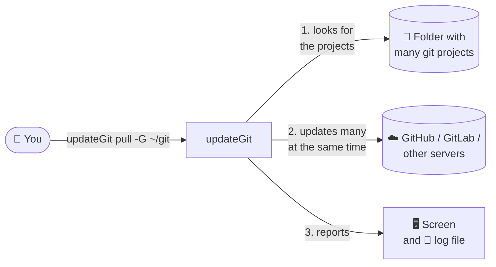

# updateGit documentation

<!-- TOC -->

- [updateGit documentation](#updategit-documentation)
  - [Who is this for](#who-is-this-for)
  - [Documents](#documents)
  - [updateGit in one picture](#updategit-in-one-picture)
  - [Glossary](#glossary)

<!-- TOC -->

## Who is this for

These pages explain **what updateGit does, how it works and how it is organized**, in plain language and with diagrams. No programming knowledge is needed. To install and use the tool, see the main [README.md](../README.md). To contribute with code, see [CONTRIBUTING.md](../CONTRIBUTING.md).

## Documents

| Document | What you will find |
|---|---|
| [How it works](how-it-works.md) | The journey of one execution, step by step: finding the repositories, updating many at the same time, backups, what is shown on the screen and in the log file. |
| [Architecture](architecture.md) | The building blocks of the tool, what each one is responsible for, how they talk to each other, how the settings are combined and how a new version is published. |

## updateGit in one picture

Think of updateGit as an assistant that walks through a bookshelf (your folder), finds every notebook that has an online copy (a **git repository**), and brings each one up to date with its online copy, many at once. At the end it gives you a report saying what was updated, what failed and why.

## Glossary

| Term | Meaning |
|---|---|
| **Repository (repo)** | A project folder controlled by git. It has a hidden `.git` folder with its history. |
| **Remote** | The online copy of the repository (e.g. on GitHub). |
| **`git pull`** | The git command that downloads the new changes of the remote into the local folder. updateGit runs it for you in every repository. |
| **Branch** | A line of work inside a repository (e.g. `main`, `develop`). The **current branch** is the one being used in the folder. |
| **Upstream** | The branch of the remote linked to the local branch (e.g. `origin/main`). Without it, git does not know from where to update. |
| **Ahead / behind** | *Ahead 2*: there are 2 local changes not sent to the remote. *Behind 3*: there are 3 changes in the remote not downloaded yet. |
| **Detached HEAD** | The folder is pointing to a specific point of the history instead of a branch. There is nothing to update automatically. |
| **Worker** | One "helper" of updateGit. With 15 workers, 15 repositories are updated at the same time. |
| **Timeout** | Maximum time allowed for updating one repository. After it, updateGit gives up on that repository and continues with the others. |
| **Backup** | A safety copy made before the update: a copy of the files or a git *stash* (the local changes are put aside). |
| **Log** | The messages written by updateGit. They can also be saved in a file. |
| **Release** | A published version of updateGit (e.g. `0.2.0`) with the files ready to download. |
