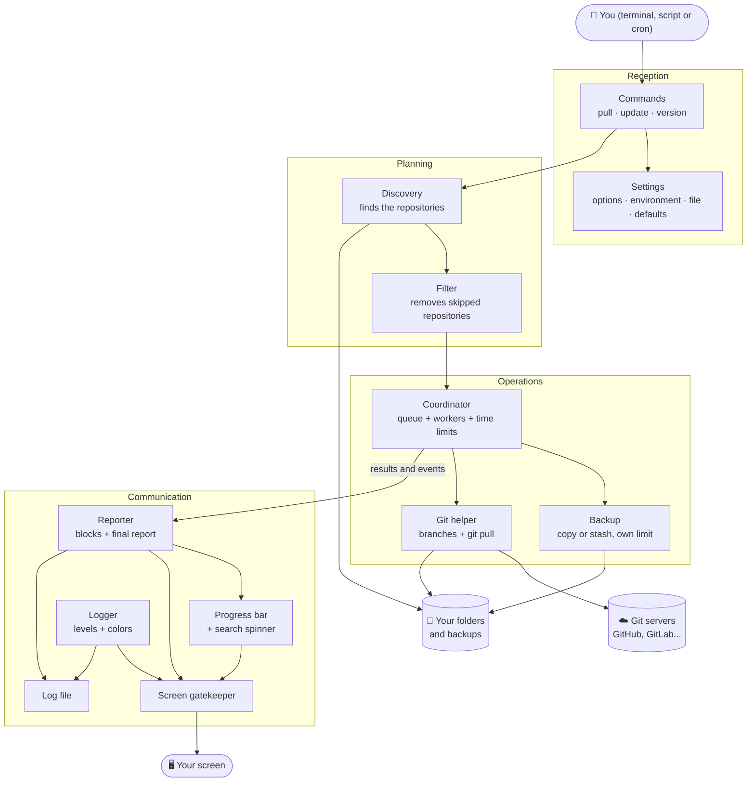
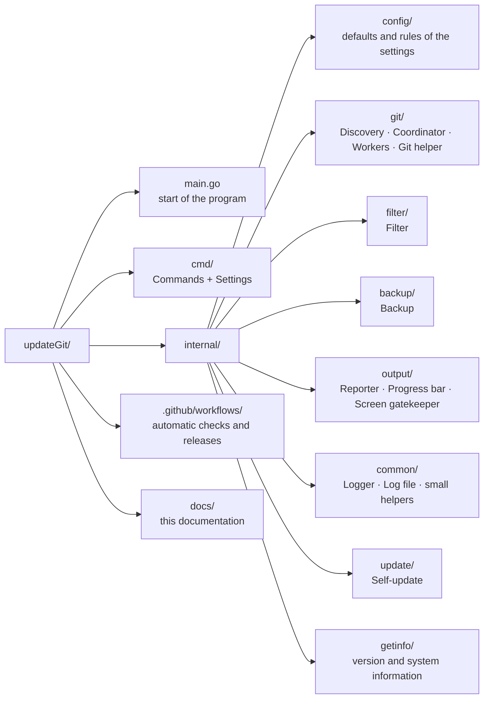
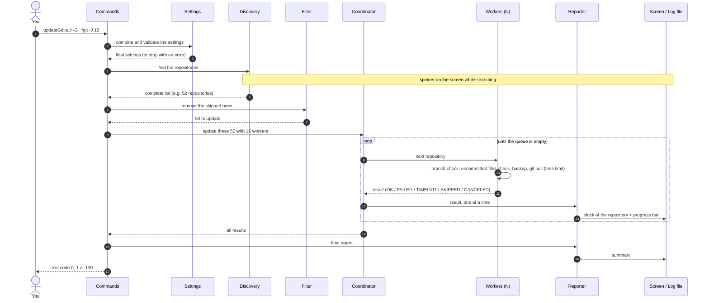
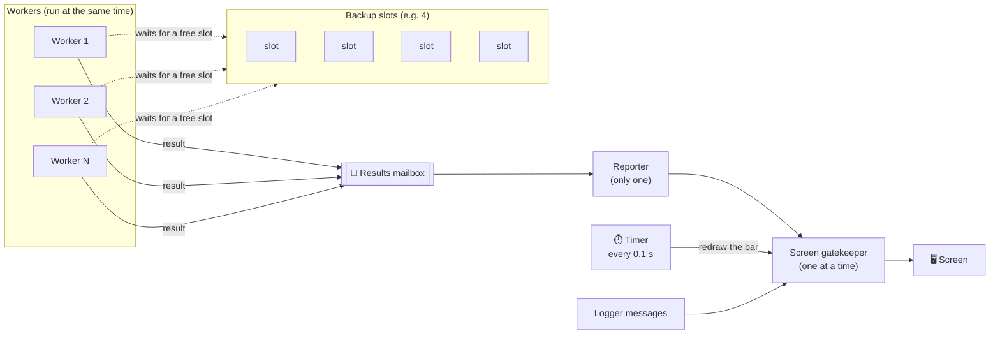
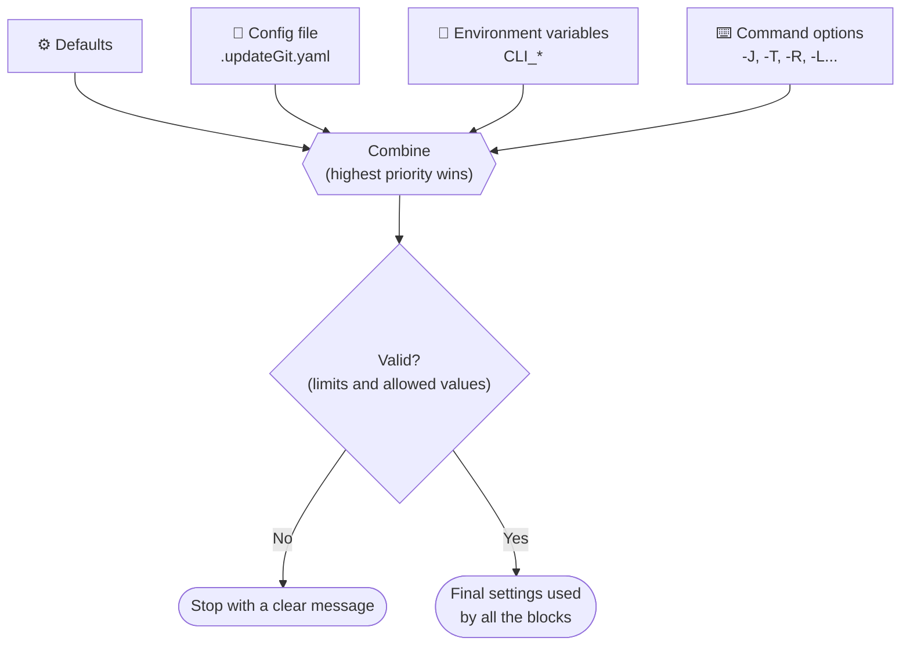
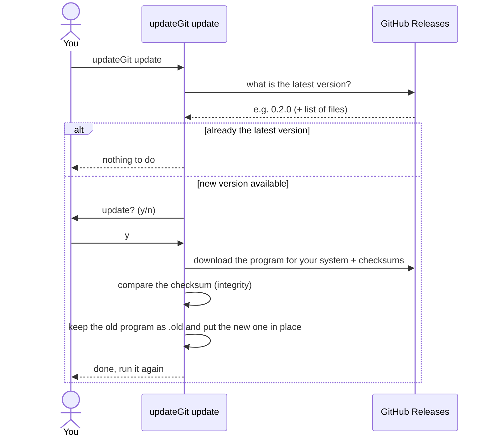

# updateGit architecture

This page shows how updateGit is organized: its building blocks, what each one is responsible for and how they work together. It does not explain the code itself. For the step-by-step journey of an execution, read [How it works](how-it-works.md) first.

<!-- TOC -->

- [updateGit architecture](#updategit-architecture)
  - [Overview](#overview)
  - [The building blocks](#the-building-blocks)
  - [Where each block lives](#where-each-block-lives)
  - [How the blocks talk during a pull](#how-the-blocks-talk-during-a-pull)
  - [Working in parallel without mixing things up](#working-in-parallel-without-mixing-things-up)
  - [Settings](#settings)
  - [Screen and log file](#screen-and-log-file)
  - [Self-update](#self-update)
  - [Quality checks and releases](#quality-checks-and-releases)
  - [Design principles](#design-principles)

<!-- TOC -->

## Overview

updateGit is a single program (one file to download, no installation of other components besides git). Inside it, the work is divided in layers, like a small company: a **reception** that receives your request, a **planning** team that decides what to do, an **operations** team that does the work, and a **communication** team that reports the results.

## The building blocks

| Block | Responsibility | Does NOT do |
|---|---|---|
| **Commands** | Understand what you asked (`pull`, `update`, `-v`), start the right flow and return the exit code (0, 1 or 130). | Any git work. |
| **Settings** | Combine the options, environment variables, config file and defaults into one validated configuration. | Decide anything about repositories. |
| **Discovery** | Search the base folder (up to 6 levels, default 2) and return the complete list of repositories, never looking inside a repository. | Update anything. It finishes before any update starts. |
| **Filter** | Remove the repositories you asked to skip (by folder name or path). | Search folders. |
| **Coordinator** (runner) | Keep the queue, start the workers, enforce the time limit of each update, limit the simultaneous backups and react to Ctrl+C. | Write on the screen. |
| **Workers** | For one repository at a time: check the branch, skip it if it has files not committed (default), make the backup, run `git pull`, classify the result (OK, failed, timeout, skipped, canceled) and explain failures. | Write on the screen or stop the program. |
| **Backup** | Make a copy of the files or a git stash before the update. | Decide when to run (the coordinator does). |
| **Git helper** | Talk to git: read the branches and their state, run `git pull` in a non-interactive way when in parallel. | Talk to the user. |
| **Reporter** | Turn each result into a readable block, write it to the screen and to the log file, update the progress bar and write the final report. | Any git work. |
| **Progress bar** | Keep the counters (done, running, backups, time) and draw the last line of the screen. | Write to the log file. |
| **Logger** | Write messages with a level (debug, info, warning, error), colors and time, to the screen and to the log file, hiding passwords. | Decide the flow. |
| **Screen gatekeeper** | The only door to the screen: erases the progress bar, writes the message, draws the bar again. | Format messages. |
| **Log file** | Create the file (`/tmp` by default, readable only by you) with a header and a footer. | Anything on the screen. |
| **Self-update** | Look for a new version on GitHub, download it, verify its checksum and replace the program. | Update repositories. |

## Where each block lives

The folders of the project follow the blocks above (you do not need to read them, this is only a map):

## How the blocks talk during a pull

## Working in parallel without mixing things up

Many workers run at the same time, but only **one** component writes on the screen. This is the main design decision that keeps the output readable:

- **Queue**: a repository is taken by only one worker, so it is never updated twice.
- **Mailbox**: workers drop their results in a mailbox; the reporter takes them one by one, in the order they finish.
- **Backup slots**: a separate, smaller limit, so heavy disk copies do not overload the computer even with 50 workers.
- **Gatekeeper**: the logger, the reporter and the timer of the progress bar all pass through the same door, one at a time. The bar is erased, the message is written and the bar is drawn again.
- **Ctrl+C**: a single "stop" signal reaches every worker. Running updates are stopped, the queue is closed and the reporter still writes a partial report.

## Settings

All settings have a default value and can be changed by a config file, environment variables or options in the command. The final value follows a fixed priority, and it is validated before anything starts:

Priority, from highest to lowest: **command options > environment variables > config file > defaults**.

## Screen and log file

The same information can go to two places, each one in its own format:

| | Screen | Log file |
|---|---|---|
| Colors and symbols | Yes, when it is a terminal (and `NO_COLOR` is not set) | Never |
| Progress bar and spinner | Yes, in a terminal with more than one worker | Never |
| Minimum level | `--log-level` | `--log-file-level` (default: same as the screen) |
| Header and footer | No | Version, command, settings, duration, exit code |
| Passwords in addresses | Hidden | Hidden |
| Who can read | You | Only you (file permission) |

## Self-update

`updateGit update` replaces the program by the newest published version, safely:

Pre-release versions (e.g. `0.3.0-rc.1`) are never offered by the self-update.

## Quality checks and releases

The same checks run on the developer's computer, before each commit/push, and on GitHub. A new version is published automatically when a version tag is created:

```mermaid
flowchart LR
    Dev(["👩‍💻 Developer"]) --> Check["make check<br/>format · lint · tests"]
    Check --> Commit["git commit<br/>(quick checks run automatically)"]
    Commit --> Push["git push<br/>(all checks run automatically)"]
    Push --> PR["Pull request"]
    PR --> CI["GitHub CI<br/>Linux + macOS<br/>all checks"]
    CI -->|approved and merged| Main["main branch"]
    Main --> Tag["Version tag<br/>e.g. 0.2.0"]
    Tag --> Rel["Release workflow<br/>validate tag = program version<br/>checks · build · verify"]
    Rel --> Page["📦 GitHub release<br/>title = tag<br/>4 programs + checksums + SBOM"]
    Page --> Users(["👥 Users<br/>download or updateGit update"])
```

The checks include: code formatting, a code analyzer (linter), automatic tests (with at least 90% of the code covered), search for known vulnerabilities, a security scan, validation of the automation files and of the diagrams of this documentation, and the build of the programs for Linux and macOS (Intel and ARM).

## Design principles

- **Find first, update later**: the complete list is known before the first update, so the progress and the report are accurate.
- **Never look inside a repository**: fast search and no "projects inside projects".
- **Isolation**: each repository is independent; one problem never stops the others.
- **One voice on the screen**: workers produce results, a single reporter shows them.
- **Limits everywhere**: number of workers, time per update, simultaneous backups and search depth.
- **Protect the user's work**: repositories with files not committed are skipped by default.
- **No surprises**: no password prompts in parallel mode, clear reasons and hints for failures, exit codes for scripts.
- **Same rules everywhere**: the checks used by developers are the same used by the automatic pipelines.
