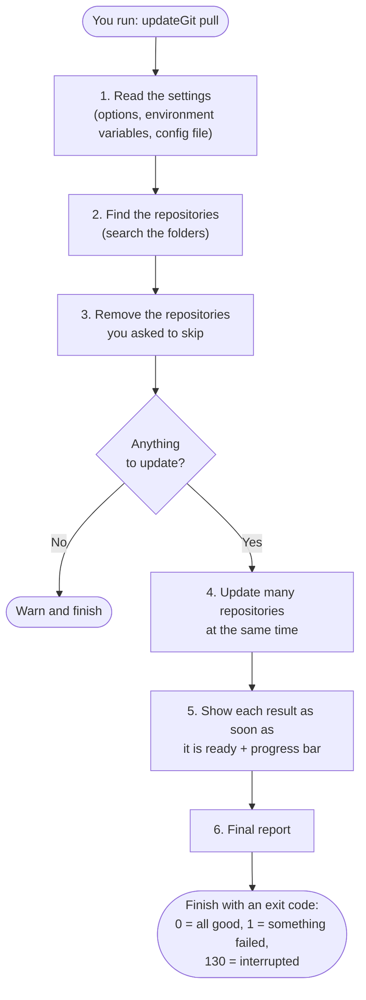
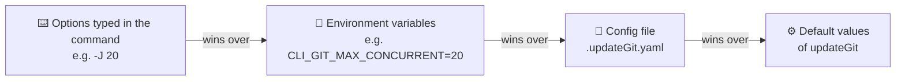
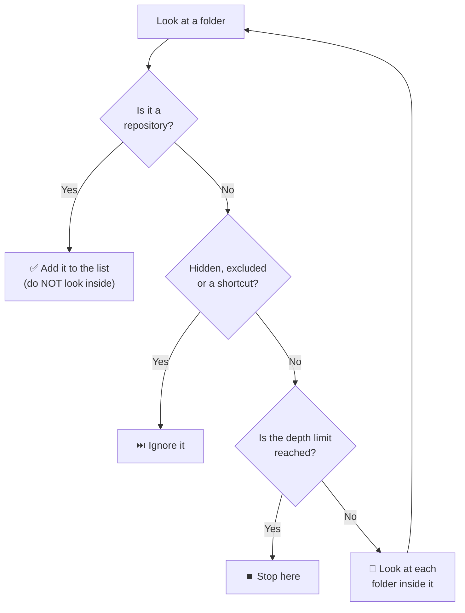
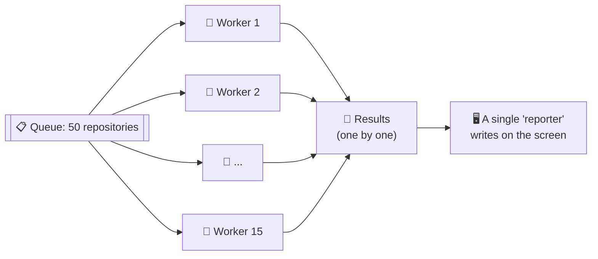
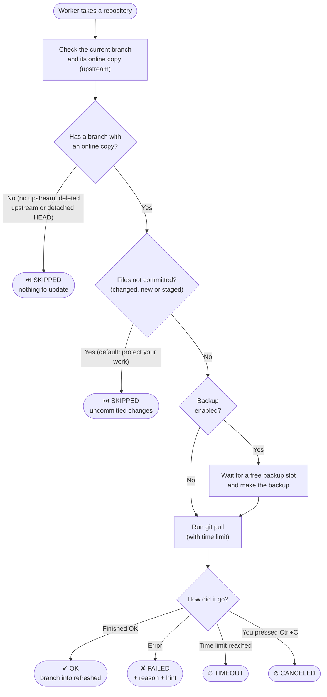
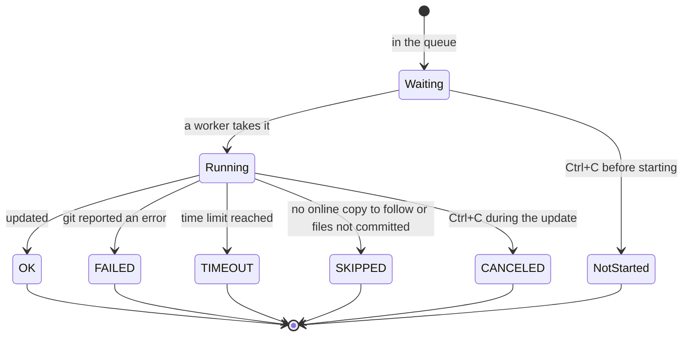
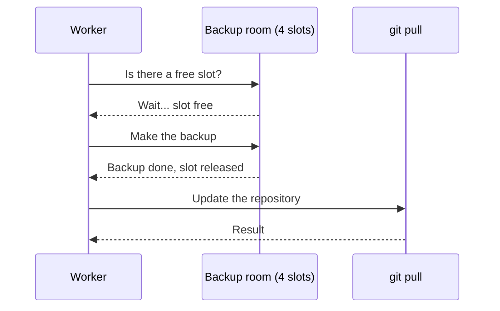
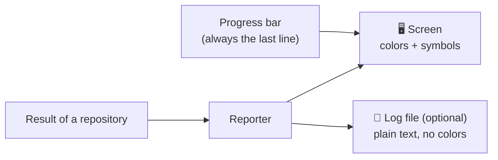

# How updateGit works

This page follows one execution of `updateGit pull`, from the moment you press Enter until the final report. No programming knowledge is needed (see the [glossary](README.md#glossary) for the git terms).

<!-- TOC -->

- [How updateGit works](#how-updategit-works)
  - [The big picture](#the-big-picture)
  - [Step 1: reading the settings](#step-1-reading-the-settings)
  - [Step 2: finding the repositories](#step-2-finding-the-repositories)
  - [Step 3: choosing what to update](#step-3-choosing-what-to-update)
  - [Step 4: updating many repositories at the same time](#step-4-updating-many-repositories-at-the-same-time)
  - [What happens with each repository](#what-happens-with-each-repository)
  - [Backups](#backups)
  - [Step 5: showing the progress and the results](#step-5-showing-the-progress-and-the-results)
  - [The final report and the exit code](#the-final-report-and-the-exit-code)
  - [Safety rules](#safety-rules)

<!-- TOC -->

## The big picture

An execution always has two clear stages: first updateGit **finds everything** that must be updated, and only then it **starts updating**. Because of this, it knows the total from the beginning and can show a real progress ("21 of 50, 42%").



## Step 1: reading the settings

updateGit can be configured in four places. When the same setting appears in more than one place, the one **closest to you** wins: what you type in the command beats everything else.



Before going on, the settings are checked (for example, the number of simultaneous updates must be between 1 and 100). If something is wrong, updateGit stops right away with a clear message, before touching any repository.

## Step 2: finding the repositories

updateGit walks through the base folder (e.g. `~/git`) looking for repositories, like someone looking for notebooks in a bookshelf with boxes inside boxes:

- It looks **2 levels down** by default, and up to **6 levels** if you ask (option `-R`).
- When it finds a repository, it **writes it down and does not look inside it**: a project is never searched for other projects inside it. This keeps the search fast.
- It skips hidden folders, folders that never contain your projects (`node_modules`, `vendor`, `.terraform`, `.venv`) and shortcuts (symbolic links), so it never walks in circles.
- If a folder cannot be read (no permission), it warns and continues.



Example with the default depth (2):

```text
~/git                         <- base folder
├── updateGit/  (repository)  <- level 1: found, not opened
├── github/                   <- level 1: normal folder, opened
│   ├── helm-charts/ (repo)   <- level 2: found
│   └── org-x/                <- level 2: normal folder, opened only with -R 3 or more
│       └── api/ (repo)       <- level 3: found only with -R 3 or more
└── node_modules/             <- ignored
```

While searching, a small spinner shows how many folders were visited and how many repositories were found. When the search ends, updateGit reports the total.

## Step 3: choosing what to update

If you asked to skip some repositories (option `-S`, e.g. `old-project`), they are removed from the list. You can use the folder name (`helm-charts`) or the path (`github/helm-charts`). The skipped ones appear at the end of the report as "Filtered out".

## Step 4: updating many repositories at the same time

Imagine a counter with several attendants (the **workers**) and a queue of repositories. Each attendant takes the next repository of the queue, updates it and takes another one, until the queue is empty. With 15 attendants, 15 repositories are being updated at any moment.



- The number of workers is the option `-J` (default 10, from 1 to 100). With 1 worker, the repositories are updated one after the other (**sequential mode**).
- The workers **never write on the screen**: they hand their result to a single "reporter". This is why the messages of different repositories never get mixed.
- Each update has a time limit (**timeout**, default 5 minutes, option `-T`). A repository that takes longer is marked as *timeout* and the others continue.

**Passwords.** When many repositories are updated at the same time, it is impossible to ask you for passwords (several questions would appear at once). So, in parallel mode, a repository that needs a password **fails with a hint**, instead of waiting forever. To type passwords, use the sequential mode (`-J 1`), or configure `ssh-agent` or a git credential helper so no password is asked.

## What happens with each repository

Each worker follows the same steps for each repository:



The possible results of a repository:



**Your work comes first.** If the current branch has files not committed (changed, new or added with `git add`), the repository is **skipped by default**, before any backup or update, so nothing you are working on can be lost or mixed with the changes of the remote. The block shows what was found (e.g. `2 modified, 1 untracked`) and the summary lists these repositories as "Skipped (uncommitted changes)". To update them anyway, use `--git-skip-dirty=false` (ideally with a stash backup, `-B -Y stash`, so your changes are put aside first).

For failures, updateGit reads the message of git and translates it into a short reason and a hint, for example:

| Reason shown | What it means | Hint |
|---|---|---|
| authentication required | The server asked for login/password or the SSH key was refused | Use ssh-agent / credential helper, or the sequential mode |
| local changes would be overwritten | You have local changes that conflict with the update (only possible with ``--git-skip-dirty=false``) | Commit or put them aside (stash) |
| local and remote branches diverged | Both sides have different changes | Resolve manually |
| connection closed by remote host | Too many simultaneous connections to the same server | Reduce `-J` or reuse SSH connections |
| could not connect / resolve host | Network problem or wrong address | Check the network and the remote address |

## Backups

If you enable the backup (option `-B`), each repository gets a safety copy **right before** its update:

- **copy**: the files are copied to a backup folder (`<backup folder>/<date-time>/<repository>`).
- **stash**: the local changes are put aside by git itself (only when there are changes).

Copying files uses a lot of disk, so the backups have **their own limit** of simultaneous copies (option `--backup-max-concurrent`, default 4), independent of the number of workers. Think of a copy room with only 4 machines: the workers wait in line for a free machine, and then go on with the update.



If a backup fails (e.g. disk full), the problem is shown in the result of the repository and the update continues.

## Step 5: showing the progress and the results

Each repository is shown in a small **block** as soon as it finishes, with its status, its current branch (and whether it is up to date, ahead or behind), its other branches and the result of the update:

```text
✔ [1/50] updateGit                                            0.8s
   ● main → origin/main · up to date
   ○ develop, feature/parallel-pull (ahead 1)
   ↓ Already up to date.
```



- **Colors** help to read: green is good, yellow needs attention, red is a problem. Without a terminal (e.g. when the output goes to a file), colors and symbols are replaced by plain text like `[OK]` and `[FAIL]`.
- **Progress bar**: in a terminal, the last line shows how many repositories are done, how many are running, the backups in progress and an estimated time to finish. It is redrawn every fraction of a second and is never written to the log file. It is turned off in sequential mode (so it does not hide password questions).
- **Message level** (option `-L`): `info` shows everything; `warning` or `error` show only the problems and the final report, which is useful for scheduled executions.
- **Log file** (option `-O`): everything is also saved in a file, by default `/tmp/updateGit_YEAR-MONTH-DAY_HOUR-MINUTE-SECOND.log`. Only you can read it, and passwords embedded in addresses are hidden.

## The final report and the exit code

At the end, the progress bar disappears and a summary is shown:

```text
════════════════════════════ Summary ════════════════════════════
  Total 50   ✔ Updated 46   ✘ Failed 1   ⏱ Timeout 1   ⏭ Skipped 2   ⌛ 41.7s
  Failed:
    ✘ private-repo    authentication required
    ⏱ huge-monorepo   timeout after 5m0s
  Skipped (no upstream): scratch, tmp-experiment
  Filtered out (--skip-repos): old-project, broken-repo
═════════════════════════════════════════════════════════════════
```

updateGit also finishes with an **exit code**, a number that scripts and schedulers (like cron) can read: `0` means everything went well, `1` means at least one repository failed or timed out, and `130` means you interrupted it with Ctrl+C.

## Safety rules

- **Nothing is updated before the settings are valid and the search is complete.**
- **Your work is protected**: repositories with files not committed are skipped by default.
- **One problem never stops the others**: a failure, a timeout or a backup error affects only that repository.
- **No waiting forever**: every update has a time limit.
- **No surprise questions in parallel mode**: password prompts are disabled; the sequential mode keeps them.
- **Ctrl+C is respected**: running updates are stopped, the ones still in the queue are not started, and a partial report is shown.
- **Secrets stay hidden**: passwords inside addresses are masked in the screen and in the log file, and the log file can be read only by you.
